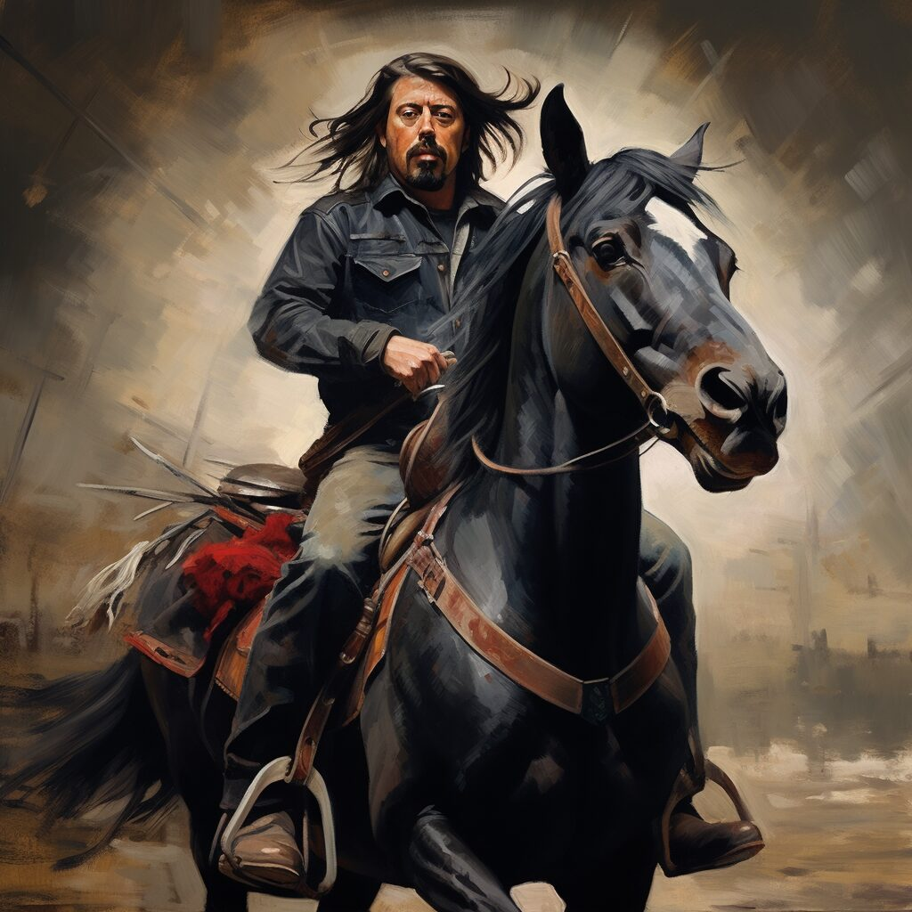

### Dave Grohl was standing in the doorway of the stable, staring at me while I had my hand halfway inside a horse.

“Umm… hi. You’re Dave Grohl.”

“I’ve been told.”

“I’m gonna grab something from the truck.”

My mind raced frantically. This was a rock god, there goes my hero, Dave-fucking-Grohl, the man, the myth, the legend, all bearded tattooed glory of him and there I was covered in horse fluids trembling like the 16-year-old punk kid that I was.

I used to make trips out to LA on break to visit my uncles. It was a good trip, something where I could hang out in the sunshine during breaks from school and since I was interested in medicine, I would go on veterinary rounds with my uncle Neil. He was a horse vet for the rich and tanned, and drove his 2004 Durango up and down the valley pushing steroids and ketamine for everyone from Schwarzenegger to Regis. Horses that is.

Since he worked 6 days a week I’d get up at the asscrack of dawn and hang with him in the back, kicking it in the jump seat of the car. Hugo his assistant would be driving while Neil fielded calls. We’d talk about life in between hopping from barn to barn, discussing family lore, his practice, questions about what it means to really work on something you love, living in Los Angeles, and shooting the shit about things that a 16-year-old would like, namely dirt on my parents and music.

At the time I was playing in an alternative rock/punk band in high school called Sane Asylum. We’d been jamming most every night for months and started playing some shows in the area. I was the singer-songwriter writing teenage angst songs while hiding cases of beer that we stole from my parents in the bass drum. Music was a big part of my life and I had these giant headphones where I’d rock out to some of the classics like AC/DC, Green Day, Nirvana and the Foo Fighters.

And here I was, quivering standing next to my uncle helping grab gear from the truck. Dave Grohl grew up in the same hometown as me, snuck into the same venues like the 9:30 Club using a fake ID same as me, went crazy in the same suburban wasteland as me, and I had the good fortune to bump into him at some stupid barn in Malibu while watching his daughter’s horseback riding practice?

Fuck me. Make a move, Roth.

I asked my uncle, “What kind of celebrities do you normally bump into during your veterinary rounds?”

He shrugged and rattled off a list of clients that included Flea from the Red Hot Chili Peppers, Steven Tyler from Aerosmith, and the founder of the Cheesecake Factory.

Rock royalty and the Cheesecake Factory. Maybe being a vet was the life for me. I imagined hanging in a hot tub with these gods while eating white chocolate raspberry cheesecake and being serenaded with anthems of the 90s.

“Can you grab these needles for me?” Neil tossed a handful of syringes my way along with some gauze. Loaded up, I stumbled back over to the barn.

What was I going to say? I needed to figure out how to calm down.

All of the sudden it struck me, the immortal words of a classic children’s novel that I had been saying to myself while scooping horse shit earlier:

Everybody poops.

It was going to be okay, just remember that Dave Grohl, founder of the supergroup Them Crooked Vultures, is a person too and he definitely has squeezed out a stinky one before.

Dave was watching his daughter trot around the ring in circles looking hella bored when I sidled up.

“So… I just got in from Annandale, Virginia. Visiting my uncle.”

“Cool… \*awkward silence\* …umm are those needles you’re carrying?”

“I’m gonna go.”

As I walked away, I realized that there was no need to be scared of Dave Grohl, former drummer of Nirvana. Probably just that morning he had laid out a stinky lincoln log in the commode.

After that, I’ve never been afraid of meeting anyone again.
