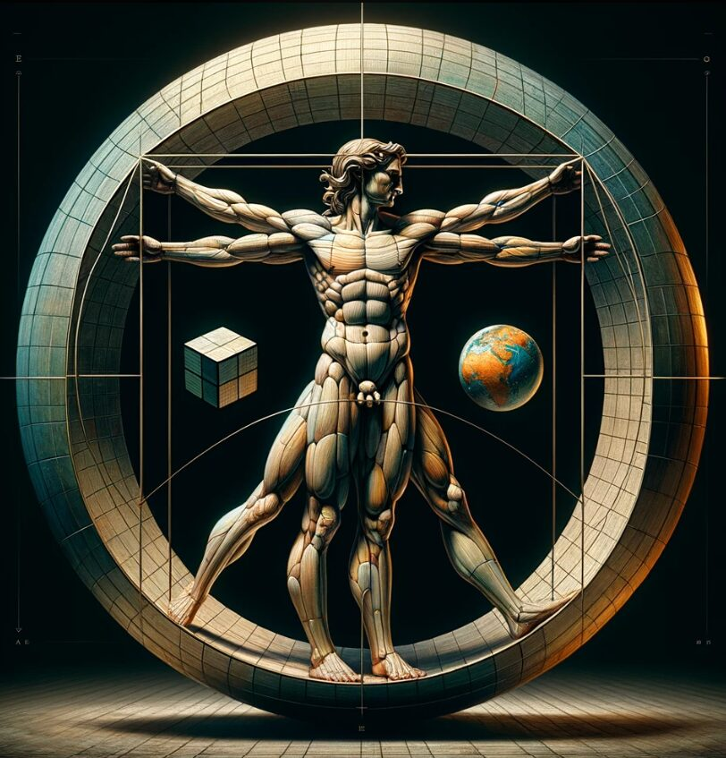

Give yourself a task to write about the description of making a box. Not just any box. The most beautiful box in all existence. And make the person making the box someone who was heartbroken once. Someone who loved in all their stolen glory. Someone who was raised religious and lost it and found it again in the box making. Someone who wished for the life of them that they could compress all the meaning and chaos and beauty in this world down into a particular shape so long as that shape was a box.

Maybe it’s a curse. This kind of box brain. Maybe they’re among a bunch of people who don’t see right-angles, who really enjoy curves. Their box-making is lost on the world of curvaceous folks (in the figurative sense) because there’s really nowhere a box could fit.

As the author, it’s my job to torture this person. To place them at a fair for people that make objects. To have a crowd come on by to admire the spheres next to them. To have them sit and hope and sit and hope until the sun goes down to only have one person come by with their wife and say “i have no clue how it would fit by the fireplace”

Have them pack up their boxes, none of them quite as beautiful as they expected and travel home to an empty bubble. The walls shrinking in as they weep and imagine the life that they hoped for. The dream of making the perfect cube a box to put everything they could ever want inside.

And at the lowest point there needs to be some kind of turn. Something to make it so that the box-maker isn’t completely destroyed by the steamroller of the world otherwise that’d just be cruel. To heap on so much pain and to never have a glimmer of a way out would be to imagine a world that is too real and too monstrous for one to comprehend (plus nobody would want to read about that reality). We read to escape the things that chase us, to dodge and run like hell for the horizon where there’s a chance of it being different, never again to be devoured.

The box-maker wanted things to be different. Realize that as the author even your imagination sometimes doesn’t know ways to make things different. Suffer the same kind of sadness as your character as you watch him take out his sandpaper and start sanding the edges of his beautiful boxes down until he’s in a pile of dust and everything is a sphere.

Maybe he sells some of the sanded down boxes at a discount. Maybe he becomes an accountant like his mother always said he should be. Maybe he puts them in his little round garage and comes back to them years later after his mother dies. He unpacks these sad sanded spheres and thinks to himself that he would try again.

Here’s the spice: bring back the hope from the outside like a wrecking ball to break the norm. The perfect oval picture frame of sameness just doesn’t seem right, what you need is violence. Everything is but a destructive act away from change.

da Vinci once spent an entire lifetime trying to square a circle. He drew endless pictures of the combination of two shapes, measuring out the frame of a man stuck between two positions then circling the whole thing as if to say “here it is! all of life right here! pay attention please!” and then he died.

All the years of toil and effort came back in that moment. He begins with framing right angles, making the perfect boxes for each one of the broken spheres. Gently he places his old dreams inside each box, a perfectly made home for every single one.

Finally, he frames up a much larger box. One to put himself inside. He steps in and closes his eyes.

Now is where you bring it home. The whole shebang. The ending to make it all worth it. The reason why the people came here in the first place. You’re making a box and it needs to fit in the fireplace of the mind. It needs to make sense in the context of the world or else the absurdity of it all will kill you. It might kill your characters and you have to go on living with the understanding that you’re a murderer, that there’s blood on the page, that every time you try to make the most beautiful box it just turns into a sphere. You’re the Vitruvian man and you don’t quite fit the perfect shape.

So the man gets in the box but the box could be anything. It could be the very best toilet in the world and he solves sanitation for millions. It could be a coffin and he dies. It could be a platform on which he finally is able to shout to all the people who walked by his stand at the market “look at how amazing everything could be if you just looked!”

But today the box is just a box and he steps out of it, a bit disappointed at himself for trying again. He lifts up the box and throws it in frustration on top of the rest of them.

Astoundingly, it doesn’t slide down. It doesn’t fall. It remains on top of one of the other boxes. The man can’t believe his eyes. Never before had he seen something like what he is witnessing.

At this point we’re seeing the magic. At this point the realization, the recognition and reckoning that everything has changed after this moment. You see our little box maker, living in a spherical world, had just discovered dimensionality.

The box maker began stacking the boxes, one on top of the other, and began to climb, reaching higher than anyone had ever gone before. Laughing in the sun.
