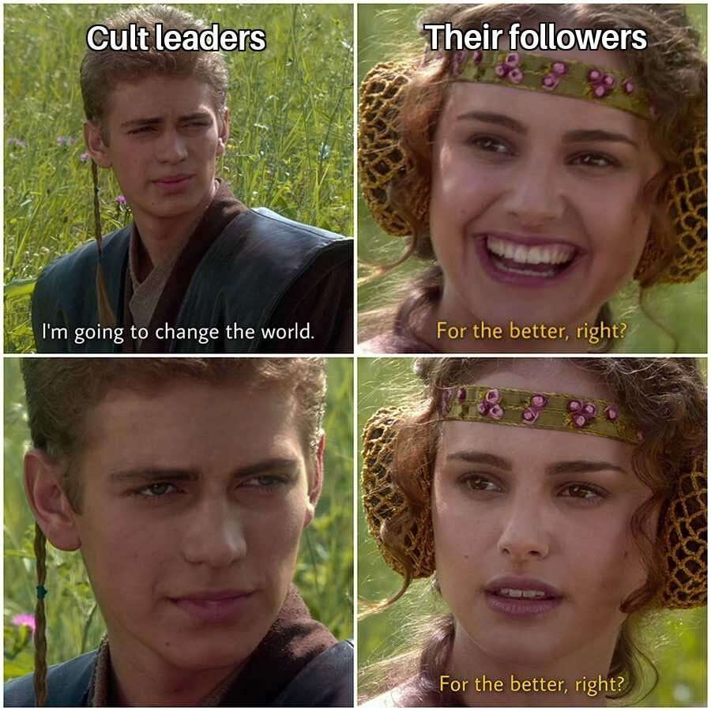

Getting bank. Printing paper. Securing the bag.

In the beginning stages of your journey as a biotech founder, it’s hella difficult to get $$$ to test out your brilliant idea.

I’ve been there. I’ve built labs in everything from a bullet-hole-ridden garage space in po-dunk Virginia, to the attic of a haunted mansion, to a shipping container cooking in the parking lot of an LA summer.

Yes, I’m jaded. If I had money I’d throw it at you. But I don’t. So instead you should check out this list of kind people who make sure you don’t have to weird out your parents with trying to make [sperm drug delivery carriers](https://thatmre.medium.com/just-keep-swimming-aa9e19323ce3).

Also because y’all will probably go through and open every single link here to completely destroy your computer’s tab count and make the onboard fan on your laptop scream like a banshee, I’ve made it easier on you by including them all in [this link](https://www.youtube.com/shorts/SXHMnicI6Pg).

### Funding for young people (sub-25 ish):

[776 Foundation](https://www.776.org/) ($100k): Focused on climate, founded by Alexis Ohanian (reddit dude).

[Thiel Fellowship](https://thielfellowship.org/) ($100k): The OG drop-out-of-school-and-build-something.

[Magnificent Grants](https://www.magnificentgrants.com/) ($100k): ([DJ Khaled voice](https://www.youtube.com/watch?v=jEI3N9kIyP4)) Another one. Drop out. You wouldn’t.

[LocalHost](https://localhosthq.com/apply) ($100k): Drop out but this time… from high school???!?!?!?!?!!!

[Z Fellows](https://www.zfellows.com/) ($10k): Interesting people. Founders Fund?

### These don’t give you money but they seem like good communities/fellowships that definitely aren’t cults:

[Foresight](https://foresight.org/): Really cool old school network of folks in frontier technology.

[Polaris](https://www.polaris-fellowship.com/): UK-based crew of folks working at the edge of the possible.

[Longevity Biotech](https://www.longbiofellowship.org/): a one-of-a-kind longevity fellowship.

[Time Initiative](https://www.timeinitiative.org/fellowship): a one-of-a-kind longevity fellowship.

[QB3](https://qb3.org/early-stage-mentoring/): Advisory program in the bay area with tons of connections.

[Berkeley I-Corps](https://www.bayicorps.com/): Do it. It’s like eating your vegetables. Probably the healthiest thing for your idea is to talk to customers.

[5050](https://www.fiftyyears.com/5050): Set up by 50 Years, seems legit.

[Activator](https://nucleate-portal.softr.app/activator): No cost biotech accelerator.

### Small Chunks of Funding for Experiments (non-dilutive):

[Awesome Foundation](https://www.awesomefoundation.org/en) ($1k): Nice group of 10ish people who put in $100 each and give out a grant a month.

[1517 Medici Grants](https://www.1517fund.com/medici-project) ($1k): Investor group that gives out funds for interesting sci-fi projects.

[Emergent Ventures](https://www.mercatus.org/emergent-ventures) (up to $15k): Doing something weird and counterculture? Tyler Cowen wants to know about it and give you $$$.

[Experiment.com Grants](https://experiment.com/grants) (crowdfunding): David Lang has been doing the lord’s work in adding fuel to the fire that is grassroots research.

[Homeworld](https://www.homeworld.bio/grants/) (variable): Do you not want the world to steadily asphyxiate from CO2? Neither do Dan Goodwin and Paul Reginato.

[ACX Grant](https://www.astralcodexten.com/p/apply-for-an-acx-grant-2024?hide_intro_popup=true) (variable): Once a year by Scott Alexander to whatever he thinks is cool.

[ValleyDAO](https://www.valleydao.bio/apply-for-funding) (variable): Those dudes Albert and Morgan who want to make things happen in biotech.

### If you’re doing biotech things, here’s a list of stuff to get early larger non — dilutive funding/support:

[Astera](https://astera.org/first-residency-cohort/) + [Astera](https://astera.org/open-science/) ($125–250k): Really Cate Hall, Seemay Chou and Jed McCaleb are single-handedly trying to shift the philanthropic ecosystem towards supporting alternative forms of research. Really cool to see.

[National Science Foundation](https://seedfund.nsf.gov/next/?slide=submityourpitch) (up to $250k): The government will give you money to work on interesting things. No strings attached except for a headache of paperwork but I [swear it’s worth it](https://medium.com/p/4373bcdb4d0b).

[Longevity](https://longevity.foundation/apply) (?): just found this one so I don’t know too much but seems fine.

[Activate](https://www.activate.org/the-fellowship) ($275k): Cool program that hooks you up with labspace, money and more.

[Breakthrough](https://befellows.smapply.org/) ($50–500k): Bill Gates is making it rain to stop acid rain (and more). Climate-focused generally.

[Echoing Green](https://echoinggreen.org/fellowship/) ($100k): Also climate focused and for underserved founders.

[O’Shaughnessy](https://www.osv.llc/oshaughnessy-fellowships) ($100k): Hard to pronounce, nice to get.

### Once you’ve really got things going, then it’s time to hit up the Vulture Capitalists. Here’s some good funds with easy applications:

[SciFounder](https://scifounders.com/scifounder-fellowship/): Founded by Nish + others, they’re good technical folks.

[NFX Bio](https://www.nfx.com/bio): I think Omri is still running this.

[Boost VC](https://www.boost.vc/): The younger Draper has an awesome group of founders in a cohort.

[PearX](https://pear.vc/pearx/): Not sure about this one but they seem nice and have good snacks.

[IndieBio](https://indiebio.co/): The original synthetic biology funders. I went through in 2016 and still heavily recommend to get started.

[Berkeley SkyDeck](https://skydeck.berkeley.edu/): Nice terms + lots of Berkeley alum support.

[YCombinator](https://www.ycombinator.com/apply): The original. Really helps with fundraising.

### Sidenote:

Just going to plug this program I got into — the [OnDeck Fellowship](https://www.beondeck.com). I’ll check them out and let y’all know how it goes.

### Conclusion

Okay now that you’ve made it to the very end, I’ve actually included a link of links with all of the applications [here](https://www.one-tab.com/page/e-T816c7Tv-R-oxJacimIg). Have fun, make good choices and build cool shit.
