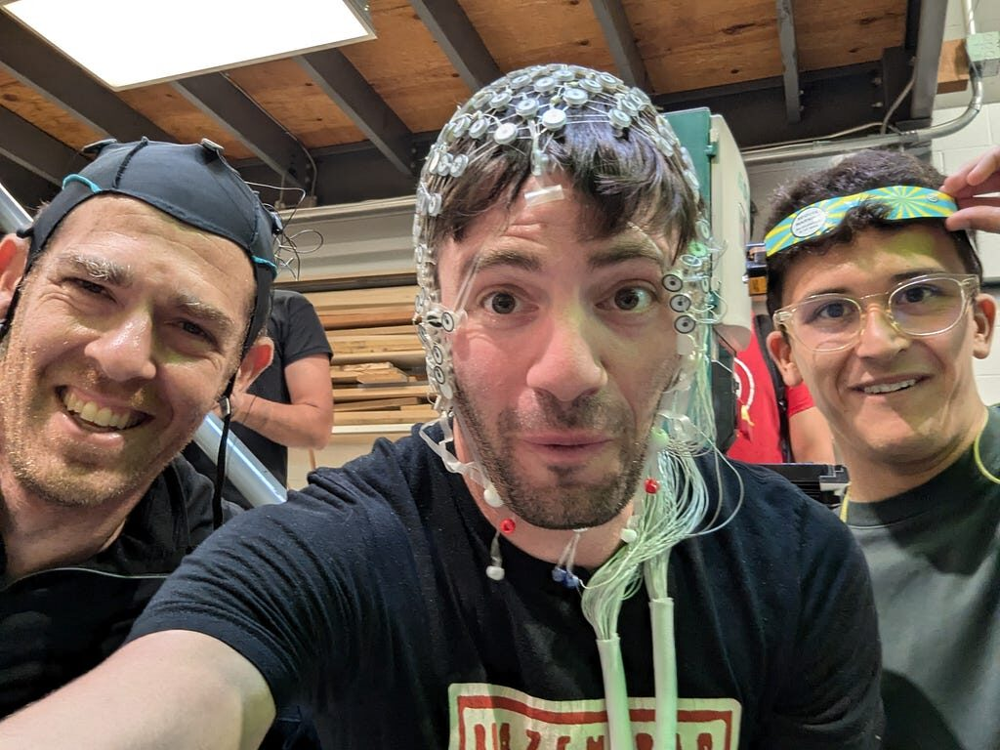

### Low Cost EEG + Brainwave Entrainment

A few weeks ago I had the good fortune of participating in an [AI + Global Health hackathon](https://lu.ma/qokre0j2?tk=c5SKUd) over at [Studio 45](http://workatthestudio.com).

I’m in the period of time in my life where I have the ability and time to play, experiment, invent and learn. One of the ideas I’ve been kicking around for a bit has been around brainwave entrainment.

Brainwave entrainment is the steady stimulation of light and sound to influence deeper waves to form in the brain. There are numerous research papers that show distinctive benefits to this kind of stimulation and the same kind of effect has been shown in a variety of cultural activities ranging from Buddhist chanting to house music.

A few months ago I met and became friends with Ben. He had been looking into treatments for his mom’s dementia and discovered brainwave entrainment. At the same time I found these Trip Glasses for $2 at the thrift store that were made by Mitch Altman. I started using the Trip Glasses and felt a distinctive benefit, reducing the amount of time I needed to sleep while improving my overall readiness scores (improvements in HRV, length of REM, etc).

We came together during the hackathon to build a neurofeedback device that took in EEG patterns and then created a constructive or destructive interference pattern with light and sound stimulation to either enhance attention and focus, or lead to relaxation and sleep.

We were joined by Ray, an amazing electrical engineer and spent 24 hours building a fun prototype of a neurofeedback device we called [Happy Noggin](http://happynogg.in).

Upon presenting, we got honorable mention for the project!

I’m aiming to continue the work by building a simplified 2-channel EEG + stimulation PCB to make a prototype consumer device. If you’re interested in learning more + following along make sure to ping me for more details.
