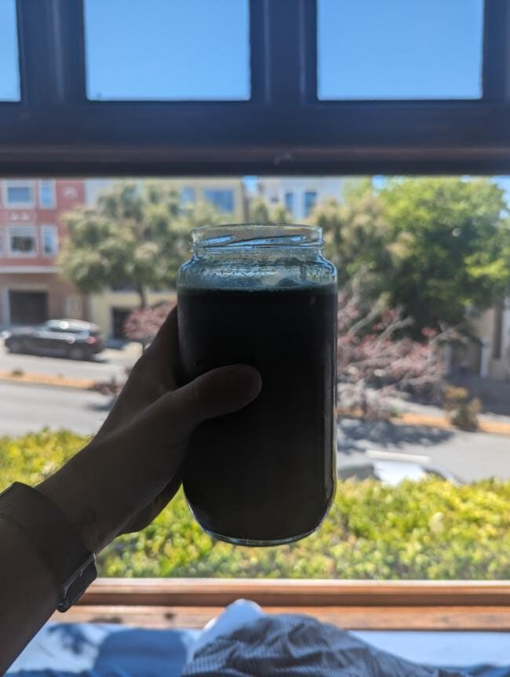

It’s been a month and I’ve been quietly testing out various aspects of going on an all algae diet as a means of generating data for an IRB (Institutional Review Board) as well as prototyping recipes using nothing but algae and water.

I think scientific research doesn’t often prototype and I really wanted to take an easier and more iterative approach. Since this is an N=1 study, I don’t have many challenges to overcome in regards to approvals except to showcase the potential downsides of the diet. That means that I get to mess with myself as a guinea pig. I decided to do a week of eating nothing but slime to see how my body responded and as a means of gearing up to longer tests and better recipes. Fun fun fun.

I kicked off the week with a 2-day fast to stabilize my gut microbiome + get a metabolic panel prior to changing my diet over. I’m an omnivore, leaning vegetarian. I guess I would categorize myself as “freegan” where I live in a vegan household and only eat meat if I’m out with other people + there aren’t other options. I tend to eat anything that’s going to be thrown away and when traveling I never make a fuss about food. I don’t have any allergies, and I’m quite regular so my gut microbiome is seemingly healthy. I eat eggs on toast for breakfast normally, with some kind of quick smoothie, salad or sandwich for lunch and a heavier dinner with a main protein, roast vegetables and grains.

As a means of starting from this baseline, I kicked off the week drinking nothing but water (with some electrolytes). I took a preliminary gut microbiome sample, started my continuous glucose measurement with Levels, and some initial metabolic testing via Forward:

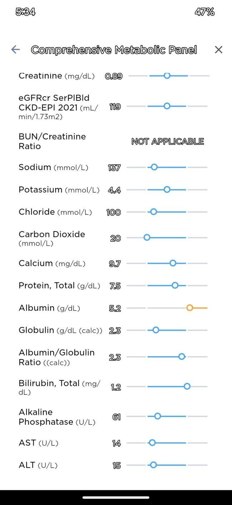

Blood albumin levels were a bit out of whack here because of slight dehydration. Besides that, everything looked average and stable.

I was a bit concerned about my liver enzymes changing over the week which had happened before when I tested some AFA previously (I do NOT recommend to eat AFA or anything wild harvested from Klamanth Lake) so I wanted to make note of my AST and ALT. Kidney function (eGFRcr) was normal.

I ran into some trouble with my doctor at Forward on scheduling an end metabolic test within the time window of the diet. I think I’ll shift over to getting a paid metabolic screen from Quest or Labcorp in the future to account for the timing of the diet. In addition, I’ll attempt to get more metabolites tested like my thyroid levels to check up on any excess iodine in my system. I’m also quite interested in what other tests I should run during the next iteration of the diet; please let me know if you have any thoughts on testing!

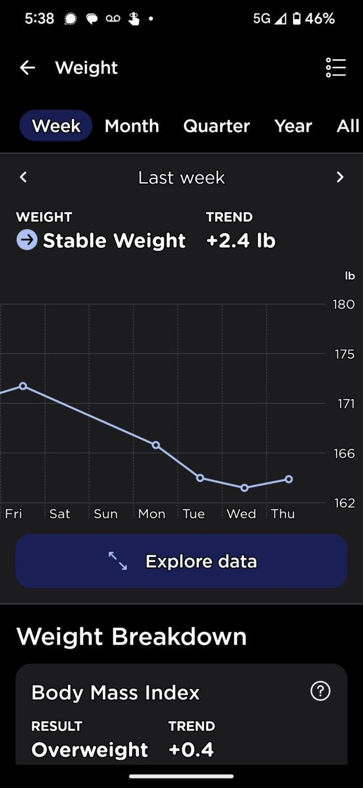

I started the fast on a Friday night and carried it through over the weekend. Initially I was in good spirits, spending time with friends, especially since I ate a high-protein meal as my last meal prior to the diet. As you can see, my weight dropped dramatically from 172 to 167 lbs over the course of 2 days. I was drinking 3+ liters of water daily so I’m guessing that this is when my body was kicking over into [ketosis](https://en.wikipedia.org/wiki/Ketosis). I was starting to burn some of my fat reserves. With a quick check of my ketone measurement device, that seemed to be true:

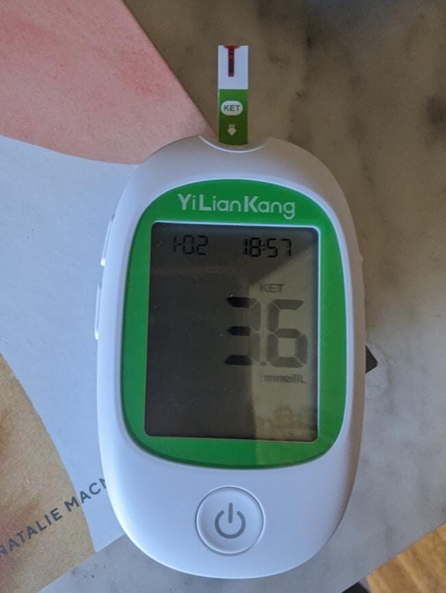

Optimal ketosis during fasting diets is defined as between [0.5mmol/L — 3mmol/L](https://keto-mojo.com/article/testing-what-should-ketone-levels-be/) which means I was a bit out of that range during the start of the diet.

I’m not entirely a fan of this method of measuring ketones as I have to jab myself and bleed a drop on the detector. The breath measurement tool seemed easier and would allow me to take more data points.

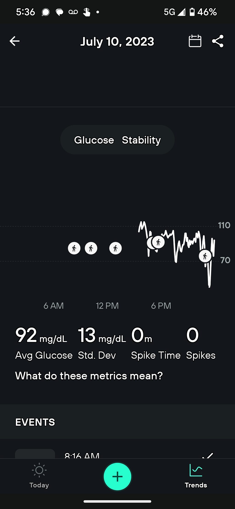

When I couple this kind of measurement with my continuous glucose sensor, it forms a more detailed picture of my blood glucose/ketone amounts and how that corresponds to overall energy changes and weight change. I’d like to test my blood glucose measurements using a finger prick as well as my Levels/Dexcom continuous blood glucose monitor just to see how the balance shifts over time.

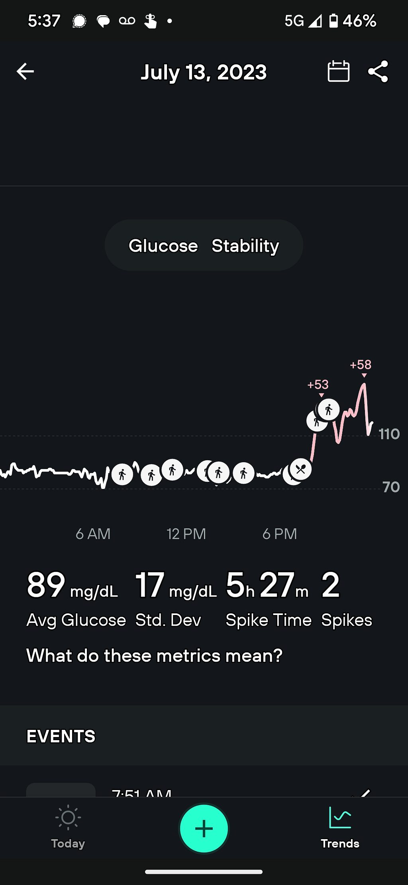

I expected to be in ketosis for the majority of the diet as the carbohydrate component of the algae is quite minimal if I’m not consuming large amounts of seaweed. It seemed like my average glucose was around 90 mg/dL which wasn’t ideal. This led to a lot of brain fog and a lack of concentration, something that might be helped in the future with more carbohydrate inputs from seaweed snacks. There were very few glucose spikes during the diet as I never consumed large quantities of food, merely snacking on small things throughout the day.

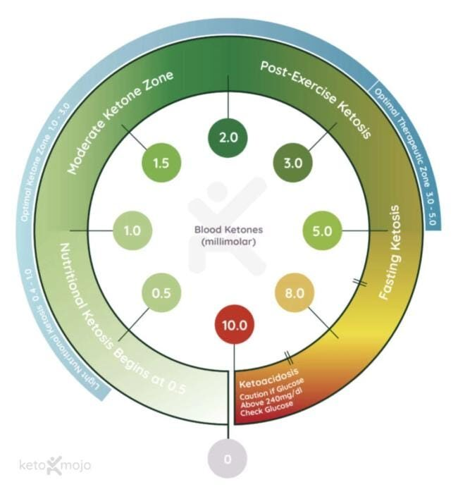

The fast went relatively quickly, I went through all my normal exercise routines, averaging at least 10,000 steps daily with energy waning a bit on Sunday. I tend to weight lift three times per week, alternate with cardio (stationary bike mostly) and have a rest day mixed in there. I definitely didn’t keep to this as the week went on and my energy waned. Luckily, San Francisco is an incredibly walkable city so I got a chance to get my steps in. I’m wondering if I should be testing my muscle mass output and trying to find a good standardized way to do that via exercise. I think one of the best methods might be getting a distal strength ([grip](https://www.physio-pedia.com/Grip_Strength)) measurement device or following in the path of [Bryan Johnson](https://protocol.bryanjohnson.co/#fitness) and using the [ACSM guidelines](https://www.acsm.org/education-resources/books/guidelines-exercise-testing-prescription). This is definitely something I’ll add to my measurements for the next algae diet testing session.

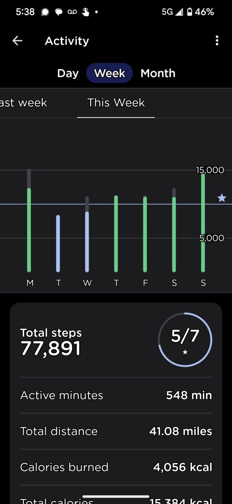

My sleep patterns were all over the place which also heavily affected the start of the diet. Sleep is really the foundation of health so I made a note to standardize sleep in the future, controlling to minimize the variability in when I go to bed, wake up and the length of time spent asleep. I tend to use a facemask and earplugs but sleep in a room that borders a busy street. Another factor at play is that I just moved to a new city, and was sleeping in a somewhat unfamiliar environment. I wasn’t getting good sleep which is something I’ll make sure to take into account for future experiments, trying to control for standardizing my sleep patterns. One of the algae supplements I could take to better improve my overall sleep patterns would be Ecklonia cava, a seaweed which has certain compounds that mimic Ambien and could help me get to sleep faster.

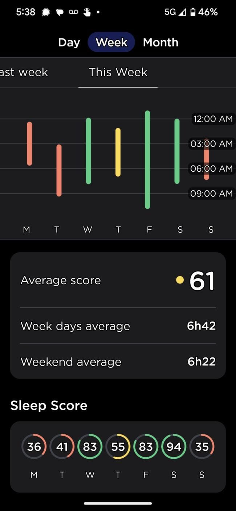

Before starting, I had charted out the basic nutrients I needed for the diet but I was lacking in calories in particular which were supposed to come from algae oil. I couldn’t find a good source of algae oil so I opted to use cultured oil instead (virtually the same) from Zero Acre Farms. Each day I was supposed to consume 2000 calories (albeit a bit low for my activity levels) which corresponds to at least 1000 cals or 125 ml of oil daily.

(ignore the percentages here + I may need to adjust for exercise + improve my overall spreadsheets based on what ingredients/recipes I have on-hand)

I’m fascinated by N=1 studies like [this one](https://slimemoldtimemold.com/2022/07/12/lose-10-6-pounds-in-four-weeks-with-this-one-weird-trick-discovered-by-local-slime-hive-mind-doctors-grudgingly-respect-them-hope-to-become-friends/) and would love to attempt to replicate something similar with algae-based foods. One of the harder parts of the diet was trying to come up with recipes that would meet all of my nutritional requirements in a way that wasn’t just eating powders and chugging water. I had all the components of a complete diet but needed to find a way to make things palatable. The recipe development took 2–3 hours at minimum each time I entered the kitchen which was really untenable with my work schedule. This is why my actual caloric consumption hovered around ~1000 calories each day, definitely well under what I wanted or needed.

The number one question I got during the diet was about my number twos:

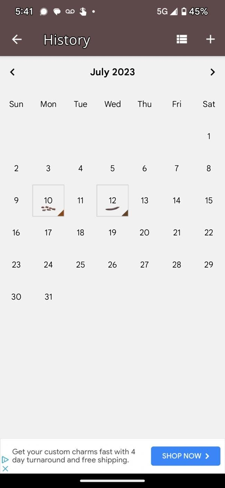

I got a really great poop tracking app that measures my bowel movements. Over the course of the week I only had two — the first seemed like a residual from the prior week but the second was interesting. A lot more green in color but besides that completely normal ranking a 5 on the Bristol Stool scale. I sent my microbiome out for analysis and discovered that my gut bacteria changed significantly just over a few days. Pathobionts went down significantly and gut diversity went up, indicating an overall beneficial change. That could be do to depressing my gut microbiome with the fast, however I was excited to see a slight change in the bacterial makeup of the gut with new species colonizing my colon (;D). I’m assuming that the effect would be even greater over time.

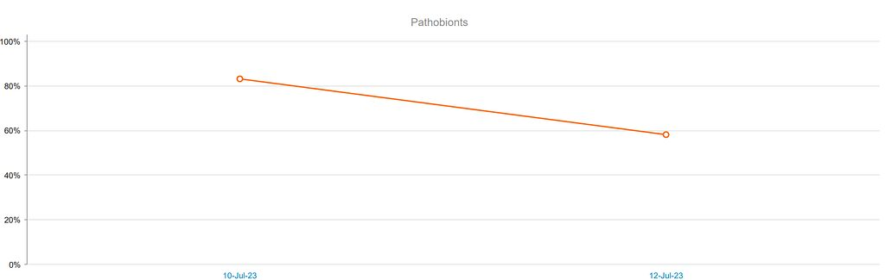

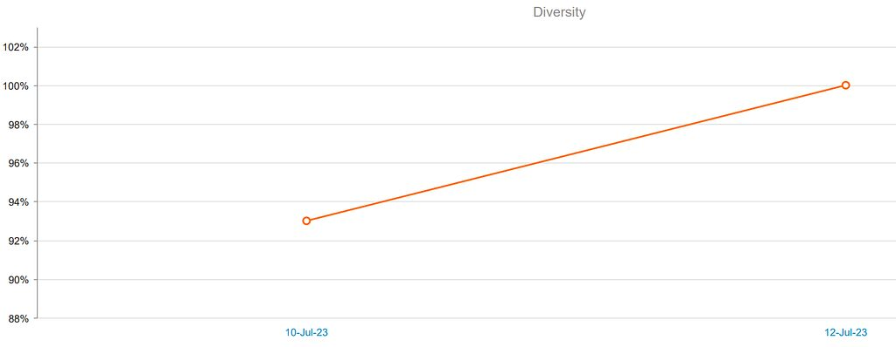

My starting heart rate variability was normal (although I’d like my resting/sleeping heart rate to be a lot lower. That just means I need a bit more exercise).

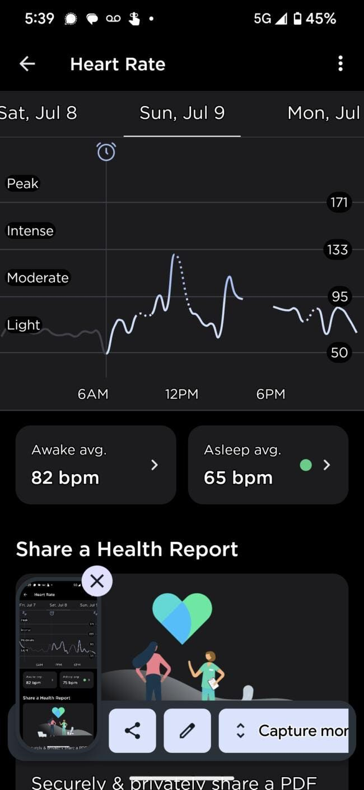

My ending heart rate variability was elevated which might indicate a stressed state. The change in diet, the lack of sleep, the consistent exercise, the challenges with getting enough calories… in the future I’d want to see a stable hrv when conducting the diet.

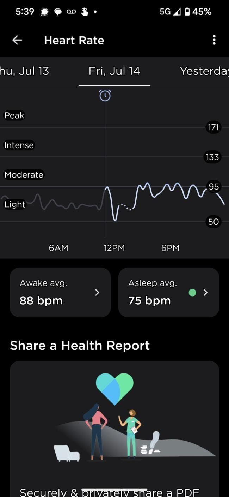

I attempted to keep a food journal and conduct urinalysis during the diet but had difficulty keeping track. I was using a notes app on my phone but if you have any specific recommendations let me know. I think in the future this is something I’ll be way more diligent about as urinalysis can yield some interesting insights about mineral content in the pee and bloodstream.

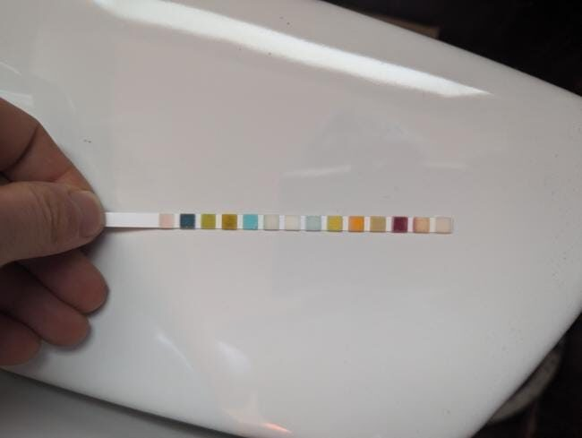

I took standard blood pressure, temperature and pulse oximetry data every morning. Not much change here on a day-to-day but still good measurement tools to check for general baseline health.

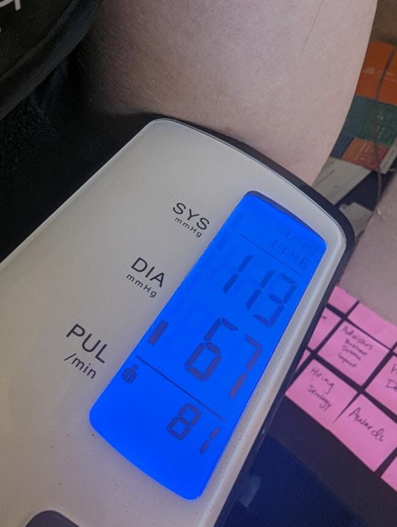

I played around a bit with my roommates [AI recipe generator](https://cookstream.ai/) to see if I could come up with a number of algae-only recipes. As for recipes, these are two that I’m particularly fond of: algae bacon pancakes and kombu broth. The first was a major challenge in getting the dough to rise properly. I think I might try with baking powder in the future which might be okay under standard diet rules as I could be flexible in terms of basic kitchen chemicals. Test of algae pancakes:

- 2 tsp algae oil

- 1/4 cup chlorella

- 1/2 tsp iota carrageenan

- 1/2 cup water

- 1 tsp blue spirulina

- 1 tsp agar agar

Add oil to the pan Heat up + flip Fry dulse bacon to serve on the side Enjoy!

")

The second recipe has become a staple. Similar to bone broth, this kombu stock is incredibly filling, super nutritionally dense and easy to make.

You start by boiling water, then adding a few blades of dried kombu, wakame, arame, and dulse to the pot then reducing to a simmer and cooking for 30 minutes minimum. Strain out the algae leave + enjoy! I started drinking this soup stock daily and it was incredibly filling. I would love to do a proper analysis to see what kind of nutritional value it has in there.

In conclusion the prototype week of eating only algae helped me learn a ton that will inform future experiments. In particular I’m quite excited to play around with new recipes with a group of people, embrace new measurement techniques and attempt another prototype week of the diet in October.

I gave a brief talk about the diet and what I learned [here.](https://photos.google.com/share/AF1QipPQOW_trnUP-rylO0AR8y2mHfjs2aOzUWuXc7Vsz9cQMEvMslPGViXJ8axdHTpiwg?key=b2MwYjNPZE9jSG5laVlSdWs3dHlYN0ZMZi0zYzZn) Super excited to share more results and experiments in the future. If you’re interested in getting involved, follow this link to participate:

[https://forms.gle/k9dPjnC4z7ZkLuaT9](https://forms.gle/k9dPjnC4z7ZkLuaT9)
