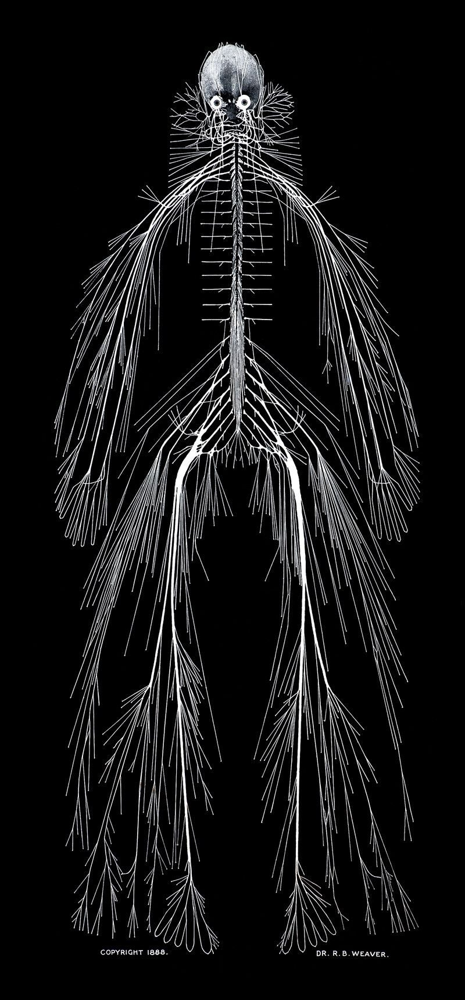
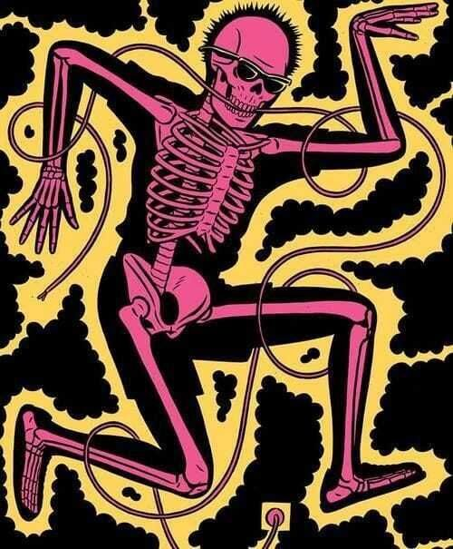
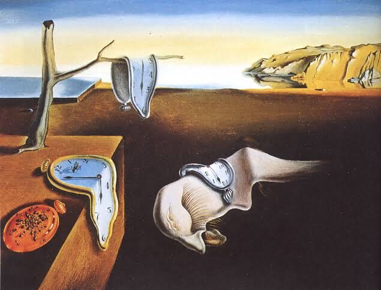
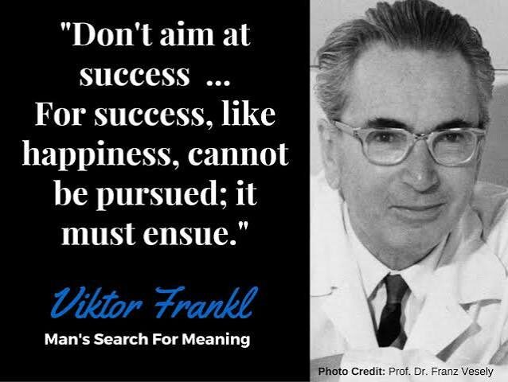
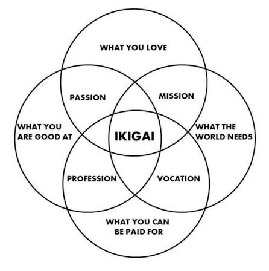

“Maybe happiness is like a virus. Maybe it's one of those bugs that sits for a long time, so we don't even know that we are infected.” ~Generosity

I’m currently reading the book Generosity by Richard Powers (a brilliant author, highly recommend) and in it the main character, an author who teaches at a local university, is fascinated and stymied by the overwhelming joy that emanates from one of his students. This student, who by all accounts should be beaten down, depressed and forlorn, is a survivor of the Algerian revolution. She lives constantly in peak experience, so much so that he goes to a psychologist to investigate if it’s hypomania, hyperthymia or something else.

Halfway through the book now, I’m am struck by how much of our experience is tempered by our hedonic set point, or your base level of happiness. I’ve been interacting routinely with a number of teams exploring joy and raising this level, so it’s been definitely top of mind. Quite simply, they’re working to tweak neurons so that they’re not sad. Kinda like turning up the color saturation on the world.

Despite being a techno-utopianist, I’m somewhat of a skeptic when it comes to neurotech in general and more broadly think that less is more when it comes to technology. Part of that is because I’ve lived on so little.

I’ve lived at the limits of survival. I’ve been homeless, I’ve suffered from food insecurity, I’ve been abused and had people do terrible things that have left me curled in a ball crying for days. But on the whole I’ve been told that I have a sunny disposition. One of the best compliments I’ve ever received was from my 5th grade teacher who said I had this _joie de vivre_, a joy of life.

Each day I wake relishing the opportunity to experience this awareness, this overall sense of awe at the absolute strangeness of it all. This is a gentle humble brag because I know many others who are glum, glower and grumpy. Who dwell in the shit and wallow in it, pulling in others to their misery.

It’s not like I never get sad or get the [morbs](https://en.wikipedia.org/wiki/Got_the_morbs). I LOVE feeling the full range of emotions and can tune the intensity up or down, like I’m playing with the volume on an amp. Once I tune past 11, this gets to the point that it’s almost as if there’s an awareness of otherness, that enables you to feel beyond the bounds of the human body. A proprioception with your social network as almost an extensible organ of humanism.

In The Body Keeps the Score, Bessel writes: “As long as you keep secrets and suppress information, you are fundamentally at war with yourself… The critical issue is allowing yourself to know what you know. That takes an enormous amount of courage.”

To be self-aware means to be honest in everything. This lets you feel completely and to envelop yourself in a trust-based community of other people who are also self-aware. That way you can be vulnerable and feel all the feels because you feel safe in both yourself and around others. This is the highest version of what Maslow calls “belonging” (to which I’ll talk about later).

I think to inhabit these spaces is a skill that can be learned, and while initially uncomfortable, raises your overall hedonic set point (which is why I love communities). This doesn’t have to be engineered via gene therapy or any complicated means, I think past initial self-awareness / honesty, it comes down to three basic principles:

## SPEED.

[Video](https://www.youtube-nocookie.com/embed/ZCKYMW68Bf0?rel=0&autoplay=0&showinfo=0&enablejsapi=0)

Utopia means “no place” because to really have a world without conflict would also mean no change, no friction. In the show PLUR1BUS, there is a virus from outer space that spreads to infect almost every human except a dozen that are somehow immune. This virus creates a hive mind across the planet in which there is no suffering and everyone is happy. A literal utopia.

In order to achieve that blissful state, you have to sacrifice your mind and give in to the collective. The main character Carol calls bullshit and resists to great hilarity.

I discussed the show with some friends in my house and canvassed them: how many would give up their individuality in order to ease their suffering? How many would join the hive mind?

You’d be surprised at how many people resonate with the aliens and would gladly take on the virus.

In San Francisco there is this drive towards efficiency and optimization. Speeding up processes, removing barriers, streamlining, cutting the fat, making it so that productivity increases exponentially without fail until the singularity. We keep getting better, faster, cheaper, and yet people are miserable, killing ourselves on the altar of birthing an AI god.

In his 1948 seminal [paper](https://people.math.harvard.edu/~ctm/home/text/others/shannon/entropy/entropy.pdf) on Information Theory, Claude Shannon wrote about the effect of _**noise**_ in the channel of information transfer between two parties. He specified mathematically that no matter how much static or noise corrupts a signal, you can still send data perfectly if you transmit below a specific speed limit, called channel capacity.

The funny thing about channel capacity is that the human mind kinda sucks in this regard. We don’t do multitasking, arguably we don’t have the ability to parse data more than ~[10 bits/sec](http://cell.com/neuron/abstract/S0896-6273(24)00808-0) outside of motor function for conscious thought. There’s a massive amount of filtering that happens prior to our awareness. While taking in an insane amount of sensory information at [~1B bits/s](https://www.caltech.edu/about/news/thinking-slowly-the-paradoxical-slowness-of-human-behavior). Paradoxically we ingest way more than we consume and the difference between these two number is at the core of anxiety.

Ductility is the physical measure of how easy it is to turn [metal into a wire](https://youtu.be/apISKQFCnu8?t=472) by drawing it through a tiny orifice. One of the byproducts of this industrial process is a ton of heat as friction. The movement of inputs through the tiny bit of awareness is what we do on a daily basis as humans. In our experience of time as linear, we are left with a continual strand of the present moment that is tempered by how ductile we parse every moment.

Mechanical-industrial processes work on the basis of speeds and feeds. These two settings control what rate of processing and how much material is fed in. One of the easiest ways to control your base level of happiness is to minimize input and slow down the rate of processing.

This is why mediation works. Closing your eyes, focusing on breath, being intentional about clearing mental space such that you bring awareness to your body. Meditation is one of the main ways that you can bring attention to the friction in your life that is caused by trying to shove in an overwhelming amount of shit into a brain that is not designed for that.

This friction is where meaning is created. It is where being present really matters. Do you ever wonder why during times of near death experiences that times slows down? It’s meant as your brain’s reaction to overwhelming stimuli to remain in the moment.

The Navy Seals repeat a saying often: slow is smooth and smooth is fast. In moments of high stress, I often repeat the mantra “you have more time” to myself as a gentle reminder that life is a lot longer and my mind can only do so much. This has brought so much ease to me in the high intensity activities I find myself in, and allowed me to welcome in more risk and more complexity.

Slow mornings, allowing the mind to work through deeper and longer thoughts is (in my opinion) the best way to live. Going slow and taking your time means there’s a greater awareness, a presence and attention, which also means overall more joy.

The same holds true in relationships. If you’re constantly rushing around during moments together, having urgency in everything, racing to the finish in life, sex, love, work, family, and more, what kind of world are you building for yourself?

Love comes when you allow yourself to slow down and luxuriate in the experience of another. When you go slow it also allows a far more enjoyable thing to occur:

## **PLAY.**

I have this habit of starting strange traditions. Whether it’s lighting a pinata on fire for my birthday, setting up a Nic Cage film festival, or running a half-marathon in honor of Lawnchair Larry, I do my best to bake goofiness into the fabric of my existence. To be labeled as weird and interesting is a high compliment because as pattern-matching freaks, it is the strangeness that slows people down and allows us to pay attention. But importantly, I don’t do things for that attention, I do things because I enjoy them.

Without play in your life, it is harder to learn, to grow, to truly dance with concepts that would normally be scary. There’s such a fear of appearing to not know what you’re doing. Plot twist: nobody knows what the fuck they’re doing. So practice in public. Because it feels good.

Animals play-hunt, babies babble, and quite honestly nobody really cares that you suck at painting, video work or that strange poem about the gunk between your toes. The default mode is that you’re the only one paying attention to the things you’re doing (see the section above). As long as you’re having a good time trying new/weird things, nothing else matters. This kind of experimentation brings transformative change, discovery and more. We imagine new worlds of possibility when we allow ourselves the safety of play.

It’s when we tie value (including self-worth and identity) to creative work is when we undermine the joy inherent in just doing things. I consistently advise founders that they are not their company (and they consistently don’t listen). I consistnetly mispell words with the recognition that it’s a way we’ve [come up with new ones](https://www.mentalfloss.com/language/spelling/11-words-started-out-spelling-mistakes). Life is deeply ridiculous and a very unserious place.

There’s an inherent tension in the mind between the creative self and the editor. In the War of Art, Steven Pressfield labels this cognitive dissonance, this forceful problematic persistent challenge as The Resistance. By separating the internal editor from the creative, you can overcome this resistance. Sometimes that involves writing drunk and editing sober, sometimes that involves large blocks of languid time where you can just exist without expectation. The creative fluidity that comes happens when you make time for play and allow yourself to be messy without editing.

A film that made an impact on my creative process is [Everything is a Remix](https://www.everythingisaremix.info/watch-the-series). The main thesis is that any creative work is a remix of another and they provide an extraordinary number of surprising examples. I would extend upon this thesis slightly to say that the other creative force is destruction. Allowing yourself to make a mess, to destroy and tear down something is part of how you make something new. San Francisco would be nothing without the 1906 fire. The twin forces of remix and destruction are a way to shape the world, gain agency and see joy permeate through work. You’re dancing on the edge of the possible and it’s even more enjoyable to do it with others.

 by Kandinsky")

One of my favorite things to witness is people playing together, particularly improvisational music. Every week on my street there’s this jazz club that has a band play. Understanding that these people are creating in the moment just on the basis of vibes and what feels good is so awe-inspiring to witness. It’s the letting go of control and outcome that allows this beauty to emerge. You’ll always let yourself down if your expectations are anything more than the basics of doing a thing. Control has a place internally but not externally.

The amount of anxiety I see from people listening to the news is insane, so much so that Johnny Harris (a guy who reports on the news) has a [Subway Take](https://www.instagram.com/p/Da5WvgiKKQi/?hl=en) of people not consuming the news. It’s something outside of our sphere of influence and locus of internal personal control. To bring happiness back to your life is to focus on the things you can play with, not war, famine, strife.

More recently I’ve been asking people: “what is your favorite San Francisco whimsy?” I’ve gotten responses ranging from [Big Wheel Racing](https://www.undergroundbigwheels.com/), to the world’s largest [pillow fight](https://sf.funcheap.com/pillow-fight-san-francisco/), to the [Bush Man](https://en.wikipedia.org/wiki/World_Famous_Bushman) and more. Makes me want to host [Whimsycon](https://whimsyconsf.netlify.app/) (speculative) to bring together more playful people.

One of the best things in the arsenal of play is to change your relationship with time by making it a routine tradition or ritual. For me that looks like morning writing, weekly dinners, monthly trips of “going to church” where I dance until I can’t feel my body, quarterly wonder-filling experiences and annual traditions set my calendar so I slow down, have things to look forward to and understand the rhythm of life has a place for discovery/creativity in all things.

But where to direct all of this living? Happiness is a warm gun and you can either point it at yourself or aim beyond.

## **WHY.**

What’s your happiest moment? Mine was leaving home the day after my 25th birthday to move to California. I loaded the back of my beat-up 2003 Chevy Malibu lovingly named Muriel and drove off into the sunset cackling and crying with laughter. I was on the way to the west, chasing a dream I had since as far as I could remember to head out to the mythic land of queen [Calafia](https://en.wikipedia.org/wiki/Calafia).

My dream was to be an algae farmer, to culture and cultivate the slime sublime and had secured some funding from the founder of Soylent in Los Angeles to set up my lab and practice at the edge of the possible.

Heart full, I was full-sending to an unknown future and had surety that this was the right steps. All because I was self-actualizing towards purpose.

Deep in the middle of the Holocaust, in the overcrowded flea-ridden starving bunks of Auschwitz, Viktor Frankl dreamed of a time beyond the camps. He had a deep certainty, a visualization of him sharing a life philosophy with the world in packed lecture halls across the globe. The thing that carried him forward beyond horror after unspeakable tragedy was Logotherapy.

Logotherapy stems from Logos, or purpose. His core concept holds simply, that if you have a why, you can bear any how.

Another way to put this is to chase after happiness, you wind up being habitually unhappy. To chase after purpose, you wind up at happiness. The people that I know of that are self-actualizing are the ones that are fundamentally enjoying life more than others. They tend to have a solidity and surety that is enviable, that enables them to move past whatever difficulty they have in life. This is all because there is something beyond themselves that they are working towards. Somewhat similar to the philosophy of the stoics (something I may write about at a later time).

Part of the way that I build my life is to understand that you cannot go after self-actualization until you’ve tackled the other rungs of Maslow’s hierarchy of needs. The base foundational level involves food, water, and shelter, something that, in a surprising twist of fate, many of us do not have even in the Western world. As you ascend up the rungs of Maslow’s Hierarchy of Needs, you end up at belonging and community, which is part of my focus of work, my core strength. Finally at the very top of the hierarchy, you end up at self-actualization or purpose-driven work. This is a calling beyond yourself that you can throw meaning into. If you don’t have a greater purpose or calling in life then the main point of what you should be working on is to discover your purpose.

A way to understand your logos is to actively filter through another concept called ikigai. Ikigai shows that you cannot just pursue your main calling but it also has to make money, create goodness, and you eventually have to be skilled at whatever task you set yourself to. If you check all four of these boxes then whatever you end up doing it will be fulfilling.

The sad fact of the capitalistic system we are born into is that you require money to survive. To live at the limits of survival is something in which you don’t accomplish the basic bottom foundation of Maslow’s hierarchy of needs. More recently there was an economic experiment that showed that anything beyond [$70,000](https://www.nytimes.com/2015/04/14/business/owner-of-gravity-payments-a-credit-card-processor-is-setting-a-new-minimum-wage-70000-a-year.html?eafs_enabled=false) (cost-of-living adjusted in the US) was considered extra and did not contribute to people’s base level of happiness. While tenuous conclusions aside, the core concept here is solid: people do not require additional money to make them happy. Money does not buy happiness. What they do require beyond a baseline is respect for their work, purpose behind their work, and an understanding of the future they are shaping.

I encounter two types of people in my life. There are those that are waiting to die and there are others who are rushing to live. I’m sure that you have found these people in your wanderings and understand what it means when someone is waiting to die. It is because they have yet to find their core why, their main reason for living and end up spending their days in distraction, dissociation and dispair.

Some end up finding this through children or work or helping others but on the whole we exist in a world that is bereft of [meaning](https://johnvervaeke.com/series/awakening-from-the-meaning-crisis/). When you surround yourself by those who are actively pursuing purpose, you bring color back into your life and understand that you too can change the way the world works. That’s part of why I enjoy creating communities of play in which people can discover what their true purpose is.

## **CONCLUSION.**

There’s this inherent tension to being human—we didn’t ask to be here and yet we exist in this beautiful chaotic mess, of having to figure out how to be in the world. Vonnegut said it best: “Hello babies. Welcome to Earth. It’s hot in the summer and cold in the winter. It’s round and wet and crowded. On the outside, babies, you’ve got a hundred years here. There’s only one rule that I know of, babies-”God damn it, you’ve got to be kind.”

The core of human experience, of having to figure out how to be in the world without guidance is overwhelming and it is easy to give in to nihilism, pessimism and aimlessness. But that’s no fun. The gallows humor is that nobody makes it out alive, so why not lean into the joy of experience?

To slow down and feel the friction, to play at the edge of the possible with others, to discover a purpose beyond yourself, all of that is at your fingertips. Now make it happen.
