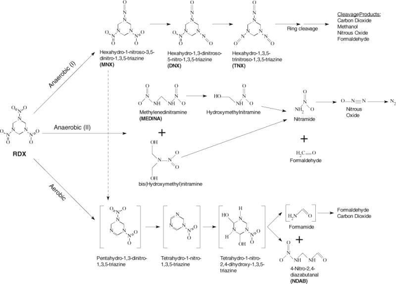
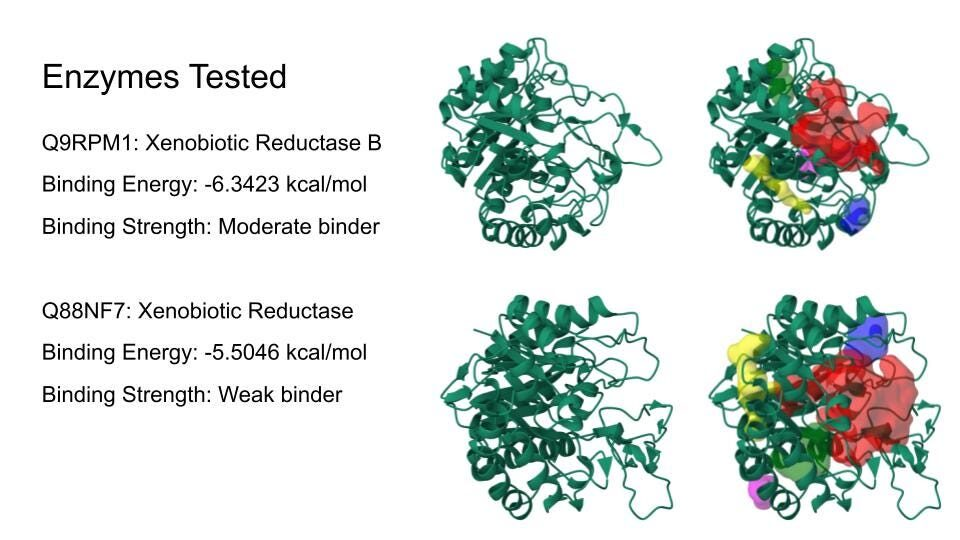

### Using AI Tools to Generate Enzymes that Break Down Land Mines

The contamination of soil with explosives, particularly RDX (Research Department Explosive), due to the widespread use of landmines poses a significant environmental and humanitarian challenge. These land mines cover a total surface area the size of Wyoming and lead to the death of thousands of children every year.

Current remediation methods are costly, slow, and often impractical in conflict zones. This project proposes to harness synthetic biology to engineer soil bacteria capable of degrading RDX in contaminated environments. By integrating specific metabolic pathways into native soil bacteria, we aim to create a sustainable and cost-effective bioremediation strategy. This approach not only promises to mitigate the environmental impact of RDX but also offers a potential tool for demining operations in affected regions.

RDX (Cyclotrimethylenetrinitramine) is a highly stable and toxic explosive compound widely used in military munitions, including landmines. Its persistence in the environment, particularly in soil, presents long-term ecological risks, including groundwater contamination and adverse effects on plant and animal life. Traditional remediation techniques, such as excavation and incineration, are both environmentally disruptive and economically prohibitive, especially in large-scale applications. Moreover, these methods are not feasible in war-torn regions where landmines are prevalent.

Bioremediation, the use of living organisms to detoxify contaminated environments, offers a promising alternative. However, natural degradation of RDX by microbes is inefficient due to the compound’s stability. Synthetic biology provides an opportunity to enhance the degradation capabilities of soil bacteria by introducing engineered metabolic pathways capable of breaking down RDX into non-toxic byproducts.

Over the course of a few hours, I worked with a team of folks to screen a number of enzymes in silico, then model the binding affinity for RDX and benchmark these enzymes to determine the right starting place for in silico mutagenesis. Next up would be generating a library of potential mutants and doing a fluorescent screen on them over on our OT-2 at [Cellsius](http://cellsius.org). Just a fun little weekend project that I hope will make the world a safer place.
